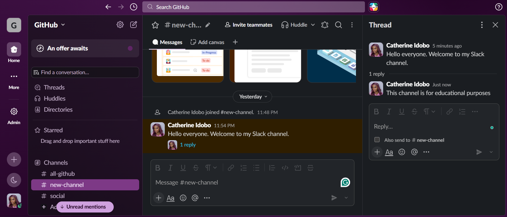

# How to reply in threads in Slack

**Time:** 1 minute | **You will need:** A Slack channel with at least one message

A thread keeps replies to one message together, so the main channel stays easy to read. In this guide, you will reply to a message in a thread and find your replies later.

## Steps

1. Open the channel that contains the message you want to reply to.
2. Move your pointer over the message. A row of icons appears on the right.
3. Select **Reply in thread**.
   
5. In the **Thread** panel that opens on the right, click the **Reply...** box and type your reply.
6. Press **Enter** to send.

Under the original message, Slack now shows a link such as **1 reply**. Select it at any time to reopen the thread.

> **Tip:** Tick the **Also send to #channel-name** checkbox under the reply box if you also want your reply to appear in the main channel.

## Find your threads later

In the left sidebar, select **Threads** to see all the threads you have joined in one place.

## Result

Your reply is saved inside the thread, and the original message shows how many replies it has.
