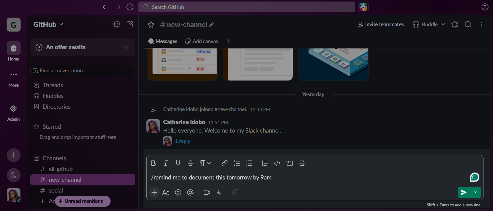
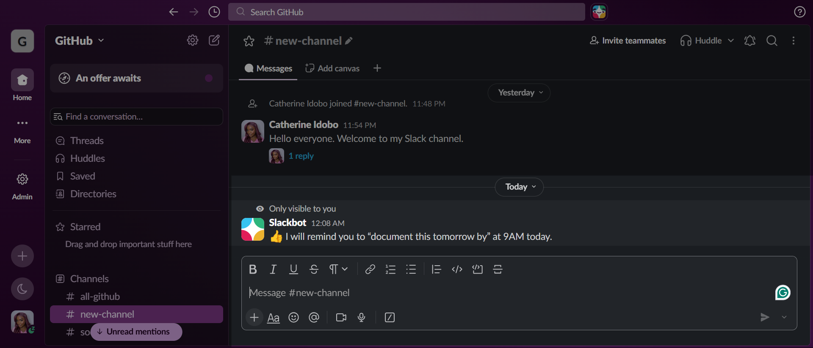

# How to set a reminder in Slack with /remind

**Time:** 5 minutes | **You will need:** A Slack workspace

The `/remind` command makes Slackbot send you a reminder at a time you choose. In this guide, you will set a reminder and view your list of reminders.

<!-- VERIFY the command wording and Slackbot messages against what Slack shows on your screen before publishing. -->

## Steps

1. Click the message box in any channel.
2. Type `/remind` followed by who to remind, what to remind them about, and when. For example:

   `/remind me to document this tomorrow by 9am`

   

3. Press **Enter** to send.

Slackbot replies with a confirmation that only you can see. It states what it will remind you about and when.

> **Tip:** Put the time at the end of the command, after the task. If the time is part of the task wording, Slack can read it incorrectly and set the wrong time.

## View your reminders

1. In the message box, type `/remind list`.
2. Press **Enter**.

Slackbot shows your reminders in a message that only you can see.

## Result

Slackbot sends you a message at the time you set.

## Next steps

- [How to build a workflow in Workflow Builder](04-build-a-workflow.md)
