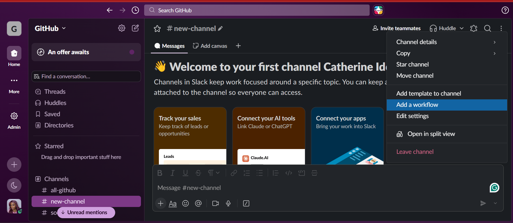
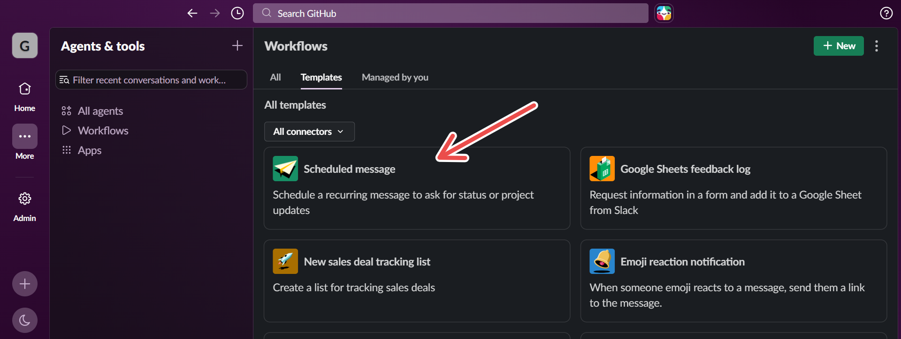
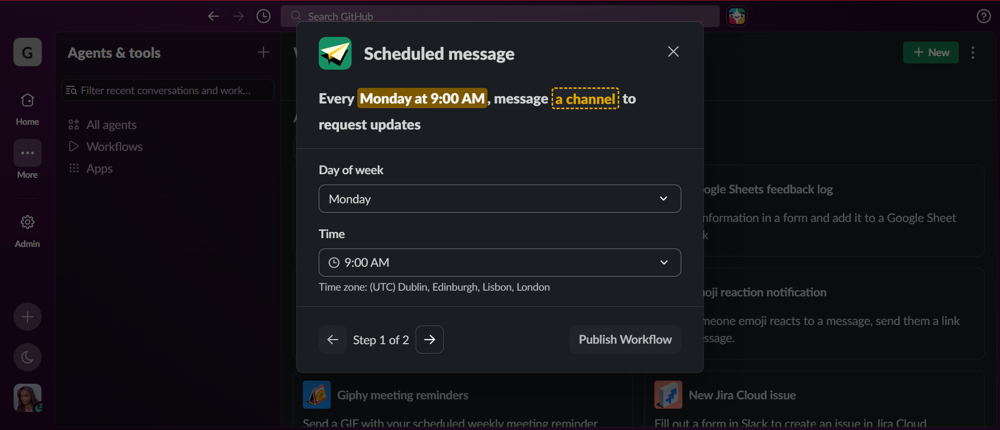
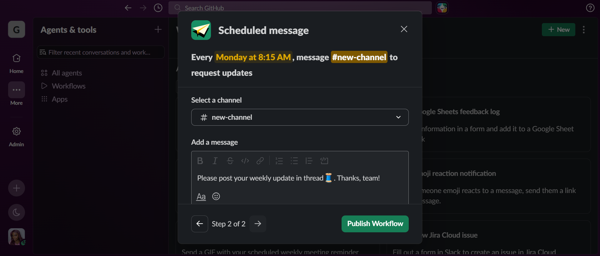

# How to build a scheduled message workflow in Slack

**Time:** 10 minutes | **You will need:** A Slack workspace where you can create workflows

A workflow is a no-code automation. In this guide, you will use a template to make Slack post a recurring message in a channel for you.

<!-- VERIFY every button name and screen title against what Slack shows. Replace every [bracket] with your own notes before publishing. -->

## Steps

1. On the top right of the screen, click the three dots and select **Add a workflow** from the dropdown menu.
2. In the **Add workflow** window, select **Browse Templates**.

   

3. Select the **Scheduled message** template. Its description says it schedules a recurring message to ask for status or project updates.

   

4. Fill in the details Slack asks for, including your channel, a message, and a scheduled day and time.

   

5. Review the summary, then select **Publish Workflow**.

   

## Next steps

- [Troubleshooting](05-troubleshooting.md)
